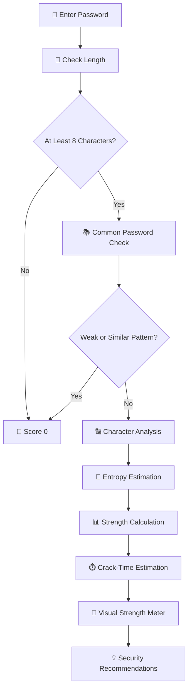

# 🔐 Password Strength Meter | Interactive Password Security Analyser

<p align="center">
  
  
  
  
  
  
</p>

## 📌 Project Overview

The **Password Strength Meter** is an interactive web-based application developed to evaluate password strength and provide users with immediate feedback on password security.

The application analyses password length, character diversity, common-password patterns, and estimated entropy to calculate a password-strength score. It also provides a visual strength indicator, security recommendations, and an illustrative estimate of theoretical password-cracking time.

Built using HTML, CSS, Bootstrap, and JavaScript, the project demonstrates how client-side programming and algorithmic analysis can be applied to improve password-security awareness.

🎓 **Academic Presentation:** ISMT College Expo 2.0  
👨‍💻 **Role:** Project Presenter  
🔐 **Domain:** Cybersecurity and Web Development

---

## 🎯 Project Objectives

- 🔐 Help users understand password strength.
- 📏 Evaluate password length and complexity.
- 🔠 Analyse uppercase, lowercase, numeric, and special characters.
- 📚 Identify common passwords and predictable patterns.
- 🧮 Estimate password entropy using a simplified mathematical approach.
- 📊 Provide a visual password-strength score.
- ⏱️ Display an illustrative password-cracking-time estimate.
- 💡 Recommend stronger password practices.

---

## ✨ Key Features

| Feature | Description |
|---|---|
| 🔑 Password Input | Allows users to enter a password for evaluation. |
| 👁️ Visibility Toggle | Shows or hides the entered password. |
| 📏 Length Validation | Identifies passwords shorter than eight characters. |
| 🔠 Character Analysis | Checks lowercase, uppercase, numeric, and special characters. |
| 📚 Common Password Detection | Checks against built-in weak-password collections. |
| 🔍 Pattern Similarity | Uses Levenshtein distance to compare similar strings. |
| 🧮 Entropy Estimation | Estimates theoretical password search-space complexity. |
| 📊 Strength Meter | Displays a colour-coded strength indicator. |
| ⏱️ Crack-Time Estimate | Calculates an illustrative theoretical estimate. |
| 💡 Security Recommendations | Displays suggestions for improving password practices. |
| ⚡ Instant Feedback | Updates results as the user types. |

---

## 🛠️ Technologies Used

- 🌐 **HTML5** — Application structure.
- 🎨 **CSS3** — Styling and interface design.
- ⚡ **JavaScript** — Password analysis and dynamic feedback.
- 🅱️ **Bootstrap 5** — Responsive layout and components.
- 🎯 **Bootstrap Icons** — Interface icons.
- 🔤 **Google Fonts** — Poppins typography.
- 🧮 **Levenshtein Distance** — String similarity analysis.

---

## 🧠 Password Analysis Methodology

The application uses a rule-based analysis system that evaluates several password characteristics.

### 1. 📏 Password Length Validation

The application checks whether a password contains at least eight characters.

Passwords shorter than eight characters receive a score of zero and a warning message.

### 2. 📚 Common Password Detection

The application maintains built-in collections of predictable passwords and patterns.

These collections include:

- Commonly used passwords.
- Personal names.
- Years and date-related patterns.
- Keyboard sequences.
- Repeated characters.
- Numeric sequences.
- Common password variations.

The application checks for exact matches, contained patterns, and similar strings.

### 3. 🔠 Character Complexity Analysis

The system checks four character categories.

| Character Type | Example | Points |
|---|---|---:|
| 🔡 Lowercase | `a-z` | 1 |
| 🔠 Uppercase | `A-Z` | 1 |
| 🔢 Numeric | `0-9` | 1 |
| 🔣 Special | `@#$%` | 2 |

### 4. 🧮 Entropy Estimation

The application uses a simplified entropy formula:

\[
H=L\times\log_2(N)
\]

Where:

- \(H\) = Estimated entropy in bits.
- \(L\) = Password length.
- \(N\) = Estimated character-set size.

The character-set size is calculated from the character categories detected in the password.

### 5. 📊 Password Strength Scoring

The overall score is calculated using:

\[
S=L_s+E_s+C_s
\]

Where:

- \(L_s\) = Length score (maximum 40).
- \(E_s\) = Entropy score (maximum 40).
- \(C_s\) = Complexity score (maximum 20).

The maximum possible score is 100.

### 6. ⏱️ Theoretical Cracking-Time Estimation

The system estimates the number of possible combinations:

\[
G=2^H
\]

It then divides the estimated number of guesses by a configured GPU guessing speed to produce an illustrative cracking-time estimate.

**Important:** This is a simplified theoretical calculation. Actual password-cracking difficulty depends on password predictability, password hashing, hardware, and attack conditions. It should not be treated as a real-world security guarantee.

---

## 📊 Password Strength Categories

| Score | Strength | Indicator |
|---:|---|---|
| Below 30 | Very Weak | 🔴 Red |
| 30–59 | Weak | 🟠 Orange |
| 60–79 | Medium | 🟡 Yellow |
| 80–100 | Strong | 🟢 Green |

The visual strength meter updates dynamically whenever the password changes.

---

## 🔄 Application Workflow

1. 🔑 User enters a password.
2. 📏 Application validates password length.
3. 📚 Common-password and pattern checks are performed.
4. 🔠 Character categories are analysed.
5. 🧮 Entropy is estimated.
6. 📊 Overall password-strength score is calculated.
7. ⏱️ Theoretical cracking time is estimated.
8. 🎨 The visual strength meter is updated.
9. 💡 Feedback and security recommendations are displayed.

### Architecture Diagram



---

## 📂 Project Structure

```text
Password-Strength-Meter-main/
│
├── README.md
├── flowchart.mermaid
└── password-strength-checker.html
```

The main HTML file contains the interface, CSS styling, and JavaScript password-analysis logic.

---

## 🚀 Installation and Usage

### 1. Clone the Repository

```bash
git clone https://github.com/roshanksah/Password-Strength-Meter-main.git
```

### 2. Navigate to the Project

```bash
cd Password-Strength-Meter-main
```

### 3. Run the Application

Open the following file in a modern web browser:

```text
password-strength-checker.html
```

You can also use Visual Studio Code with the Live Server extension.

### 4. Test the Application

1. Enter a sample password.
2. Observe the password-strength indicator.
3. Review the feedback and estimated cracking time.
4. Toggle password visibility using the eye icon.
5. Modify the password and observe how the assessment changes.

---

## 📈 Project Outcomes

The implemented application demonstrates:

- ✅ Real-time password-strength evaluation.
- ✅ Password length validation.
- ✅ Character diversity analysis.
- ✅ Common-password and predictable-pattern detection.
- ✅ String similarity checking using Levenshtein distance.
- ✅ Simplified entropy estimation.
- ✅ Rule-based strength scoring.
- ✅ Illustrative cracking-time estimation.
- ✅ Interactive visual feedback.
- ✅ Password security recommendations.

**Evaluation note:** The repository does not currently include a formal benchmark dataset or measured security-improvement results. Quantitative performance claims should be added only after testing.

---

## 🎓 ISMT College Expo 2.0

This project was presented at **ISMT College Expo 2.0**.

As the project presenter, I demonstrated how password characteristics can be analysed using JavaScript-based algorithms and how interactive feedback can help users understand password security.

### Skills Demonstrated

- 🔐 Cybersecurity awareness.
- 💻 Front-end development.
- ⚡ JavaScript programming.
- 🧮 Algorithmic problem-solving.
- 📊 Rule-based analysis and scoring.
- 🎨 User-interface design.
- 🗣️ Technical communication and project presentation.

---

## ⚠️ Limitations and Responsible Use

- The entropy calculation is a simplified theoretical estimate.
- The built-in weak-password dictionary cannot identify every compromised password.
- The scoring formula is a heuristic, not a recognised security certification.
- The cracking-time estimate uses a fixed assumed attack speed.
- A high score does not guarantee that a password is secure.
- The project is an educational password-analysis prototype, not a replacement for professional password-security systems.

The application is designed as a browser-side demonstration. Users should never enter real account credentials into an untrusted demonstration page.

---

## 🔮 Future Enhancements

- 🧠 Integrate a recognised password-strength estimation library.
- 📚 Expand weak-password and compromised-password detection.
- 🔐 Add privacy-preserving compromised-password checks.
- 📊 Introduce automated test cases and evaluation reports.
- 🎨 Improve the user interface and accessibility.
- 📱 Improve mobile responsiveness.
- ⚡ Optimise string-similarity calculations.
- 🧪 Compare the current scoring algorithm against established password-strength tools.
- 📖 Add detailed technical documentation and screenshots.

---

## 👨‍💻 Author

**Roshan Kumar Sah**

🎓 BSc (Hons) Computer Systems Engineering  
🏫 University of Sunderland (UK) — delivered through ISMT College, Nepal  
🎤 Presenter — ISMT College Expo 2.0

🔗 **GitHub:** https://github.com/roshanksah

---

## ⭐ Acknowledgement

This project represents my academic exploration of cybersecurity, password security, algorithmic analysis, and interactive web development. It provided practical experience in designing a browser-based tool that evaluates password characteristics and communicates security feedback to users.

Thank you for exploring my project! ⭐
